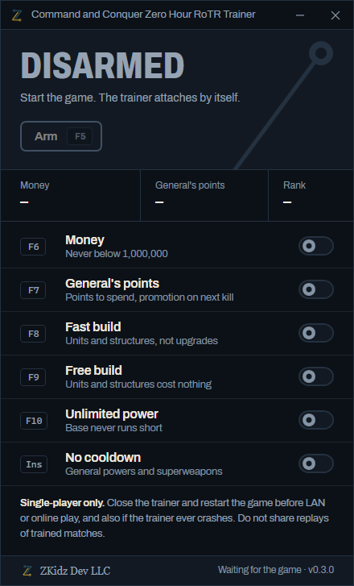

# Command and Conquer Zero Hour RoTR Trainer

A single-player trainer for **Command & Conquer: Generals – Zero Hour** running the **Rise of the Reds** mod through GenLauncher. Made by ZKidz Dev LLC.



It is a small Windows program that attaches to the running game and changes a few values for the local human player only. AI players are not affected.

## Status

Early and lightly tested. It has been used on one machine, with Rise of the Reds 1.87 Public Build 2.0 started from GenLauncher (which runs the game as `modded.exe`). The code has automated tests but has not had an independent review yet. Use it at your own risk.

## Features

| Hotkey | Feature | What it does |
| ------ | ------- | ------------ |
| F5 | Arm / disarm | Nothing is changed until the trainer is armed. It disarms itself when a match ends. |
| F6 | Money | Keeps your money at or above 1,000,000. |
| F7 | General's points | Keeps general's points available and promotes you on your next kill. |
| F8 | Fast build | Units and structures build in a fraction of the time. Upgrades keep their normal time. |
| F9 | Free build | Units and structures cost nothing. |
| F10 | Unlimited power | Your base never runs short of power, and a power sabotage ends within a moment. |
| Insert | No cooldown | General powers, superweapons and unit abilities are ready again straight away. |

All six work by changing values in the game's memory. No game code and no game file is modified.

## Single-player only

- The trainer arms only in campaign and skirmish games, and only when the game has no network connection open.
- Close the trainer and restart the game before any LAN or online session.
- If the trainer crashes or is closed by force, restart the game before any network play.
- Replays of trained matches will not play back correctly. Do not share them.
- Memory changes desync a multiplayer game, and the trainer refuses to arm in LAN, online or replay games.

## Requirements

- Windows 10 or 11, 64-bit
- The game running as `modded.exe` (GenLauncher's default) or the retail 1.04 `game.dat`. Other builds are refused: the Steam 2025 build and the community `generalszh.exe` build are not supported.

## Using it

1. Unzip the release into a folder only administrators can write to, for example `C:\Program Files\RoTR-Trainer\`. The trainer runs as administrator, so anyone who can change its folder could run code as administrator. It refuses to start from a folder that ordinary programs can write to.
2. Start `RotrTrainer.exe` **before** the game. Windows asks for administrator rights: the game runs elevated under GenLauncher, and a non-elevated program cannot open it.
3. Start Rise of the Reds from GenLauncher and enter a skirmish. The trainer attaches by itself.
4. Press F5 to arm, then the feature hotkeys. The window does not take focus from the game, so clicking its switches works too.

Starting the trainer while the game is already on screen brings up the Windows administrator prompt over it, which can leave the game's picture black. Start the trainer first.

## Known issues

- **Saving with fast build, free build or unlimited power on keeps the effect in the save**, even with the trainer closed. Turn them off before saving if you do not want that.
- **Unlimited power turned on while the base is already in low power** lifts at the next power change (build or sell any building).
- **Long matches with very large armies can crash the game.** The cause is not confirmed. The leading suspect is the 32-bit game running out of memory: in recorded matches it reached 87% of its 2 GB limit within 18 minutes.
- **Experimental code patches** (`--code-patches`: instant upgrades, a fix for a known engine crash) black out the game's picture on the test machine and are off by default. The cause is not yet known. They change the game's code in memory, so close the trainer and restart the game before any network play after using them.

## How it works

- The game binary is identified by its SHA-256 hash. Unknown builds are never written to.
- Addresses are found by byte signatures that must match exactly once. Nothing is hard-coded per machine.
- Every tick the trainer re-reads the local player from the game, checks its guards (game mode, no network endpoints, local player present, not an observer, not defeated) and only then applies the enabled features.
- The game process is opened with only the rights needed to read and write its memory; the right to pause it is requested only for the experimental code patches.
- It makes no network connections. It only reads the local socket table, to refuse games that have a connection open. There is no auto-update and no injected DLL.
- Before any write it checks that the running game matches the file on disk.

Technical notes on the addresses and patch sites are in [`docs/anchors.md`](docs/anchors.md).

## Building

```
dotnet build RotrTrainer.sln -c Release
dotnet run --project tests/RotrTrainer.Tests
dotnet publish src/RotrTrainer.App -c Release -o publish
```

Requires the .NET 8 SDK. There are no NuGet dependencies. The published build is self-contained, so it needs no separate .NET install. Some tests read the game's binaries from the default Steam install path and fail if the game is not installed there.

## Licence

No licence has been chosen yet. Until one is added, the code is published for reading only.

Command & Conquer and Generals are trademarks of Electronic Arts. This project is not affiliated with or endorsed by Electronic Arts, the Rise of the Reds team, GenLauncher or GenTool.

The typeface is Archivo, under the SIL Open Font License (`src/RotrTrainer.App/Assets/Fonts/Archivo-OFL.txt`).
